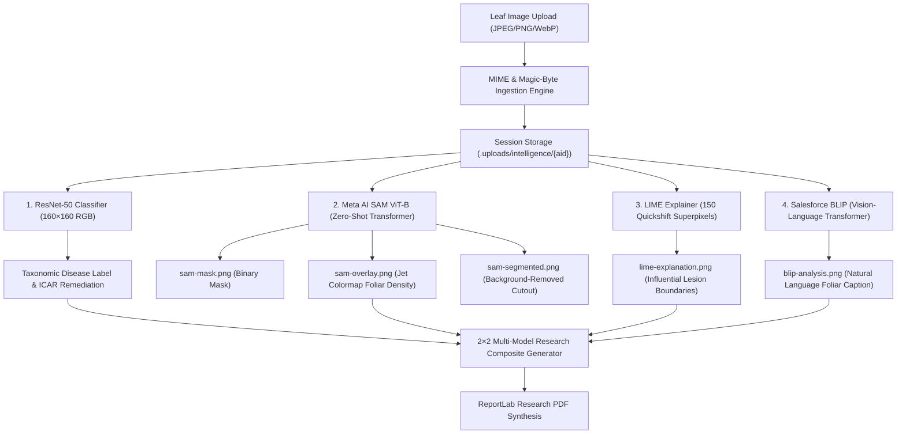
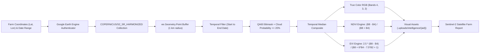

# 🏗️ KshetraIQ Technical Architecture & Systems Specification

This document details the software architecture, data pipelines, model inference topology, and security boundaries of the **KshetraIQ** agricultural intelligence platform.

---

## 1. High-Level Architecture Topology

KshetraIQ employs a modular, tri-engine architecture designed for high availability, deterministic agronomic safety, and real-time multi-modal inference:

```
┌────────────────────────────────────────────────────────────────────────┐
│                        Next.js 15 Client Layer                         │
│   • Bilingual English/Telugu Dashboard  • Plant Multi-Model Workspace  │
│   • Satellite GEE Sentinel-2 Workspace • Rythu AI Floating Chatbot     │
└───────────────────────────────────┬────────────────────────────────────┘
                                    │ HTTP / JSON / Multipart
                                    ▼
┌────────────────────────────────────────────────────────────────────────┐
│                        FastAPI 0.159 API Gateway                       │
│   • /api/v1 (Core Agronomic, Predictions, Mandi, Chat)                 │
│   • /api/plant-intelligence (ResNet50, SAM ViT-B, LIME, BLIP)          │
│   • /api/satellite-intelligence (Google Earth Engine Sentinel-2)       │
│   • Session Authentication & Ownership Middleware                      │
└───────┬───────────────────────────┬────────────────────────────┬───────┘
        │                           │                            │
        ▼                           ▼                            ▼
┌──────────────────┐    ┌────────────────────────┐   ┌───────────────────┐
│ Agriverse Core   │    │ Plant Intelligence     │   │ Satellite Remote  │
│ ML Model Cluster │    │ Vision Cluster         │   │ Sensing (GEE)     │
│ • Random Forest  │    │ • ResNet-50 Disease    │   │ • Sentinel-2 L2A  │
│ • LightGBM 500   │    │ • Meta AI SAM ViT-B    │   │ • Cloud/Cirrus QA │
│ • XGBoost Risk   │    │ • LIME (150 superpx)   │   │ • NDVI Computation│
│ • PPO RL Policy  │    │ • Salesforce BLIP      │   │ • EVI Computation │
└───────┬──────────┘    └───────────┬────────────┘   └───────────┬───────┘
        │                           │                            │
        └───────────────────────────┼────────────────────────────┘
                                    ▼
┌────────────────────────────────────────────────────────────────────────┐
│                     Physical & Regulatory Safety                       │
│   • ICAR Volumetric Water Budgeting • ANGRAU Soil Chemistry            │
│   • Zero-Hallucination Guardrails   • ReportLab PDF Report Builders    │
└────────────────────────────────────────────────────────────────────────┘
```

---

## 2. Multi-Model Plant Foliar Intelligence Architecture

The Plant Intelligence microservice (`/api/plant-intelligence`) integrates four complementary machine learning architectures from a single leaf photo upload:



### Component Breakdown:
1. **ResNet-50 Classifier:** Evaluates 23 pathogen classes across 5 crop species (Apple, Corn, Grape, Potato, Tomato) with confidence scoring.
2. **Meta AI SAM ViT-B (`sam_vit_b_01ec64.pth`):** Runs prompt-free dense grid segmentation (`points_per_side=16`) to isolate plant leaf tissue from soil, shadows, and background clutter. PyTorch 2.6+ compatibility is handled with scoped `weights_only=False` unpickling.
3. **LIME Explainer:** Perturbs 150 local superpixels to identify which specific regions drove the classifier's diagnosis.
4. **Salesforce BLIP:** Generates human-like captions describing visible physical features (spotting, leaf edge curling, chlorosis).
5. **2×2 Composite Grid & PDF Engine:** Renders a 4-panel visual breakdown combining Original image, SAM overlay, LIME superpixels, and BLIP caption, compiled into a downloadable research dossier.

---

## 3. Satellite Remote Sensing (Google Earth Engine) Architecture

The Satellite Intelligence microservice (`/api/satellite-intelligence`) connects with Google Earth Engine to provide automated, cloud-masked Sentinel-2 vegetation health metrics:



---

## 4. Calibrated Machine Learning Cluster (Agriverse Core)

| Model Name | Type | Specifications | Benchmark | Primary Purpose |
|:---|:---|:---|:---|:---|
| `crop-recommendation-v1` | Random Forest | 200 trees, Gini split | **99.3% Accuracy** | 22-crop multi-candidate ranking from soil chemistry |
| `crop-yield-v1` | RF Pipeline | OneHotEncoder + RF | **$R^2 = 0.9802$** | Expected metric tons/hectare production |
| `climate-scenario-v1` | Sensitivity RF | Drought perturbation | Empirical tables | Crop yield under -10% and -25% moisture stress |
| `sustainability-v1` | Deterministic Index | Continuous formula | 0–100 score | Eco-efficiency and chemical input optimization |
| `weather-risk-v1` | XGBoost | `multi:softprob` (4 classes) | **87.4% Accuracy** | Meteorological shock categorization |
| `market-price-v2` | LightGBM + Persistence | 500 trees + Spot | $R^2 = 0.834–0.979$ | Mandi modal price projection ($h \le 14$ days) |
| `irrigation-rl-v1` | PPO Policy | Box(6,) ActorCritic | Pure NumPy inference | Soil-moisture-conserving irrigation schedule |
| `plant-disease-v1` | ResNet-50 | 160×160 RGB | **88.2% Accuracy** | 23-class foliar pathology diagnosis |

---

## 5. Security & Isolation Boundaries

1. **User Identity & Multi-Tenancy:**
   - Tokens transported in `HttpOnly`, `SameSite=Lax`, `Secure` cookies.
   - Farm assessments, plant intelligence runs, and satellite sessions are keyed to authenticated user IDs with SQLite row-level validation.
2. **Safe Model Ingestion:**
   - SAM checkpoint integrity verified with strict size gating (`> 10 MB`) to prevent Git LFS pointer files from being executed.
   - PyTorch 2.6 safe loading wrapped in scoped try/finally blocks.
3. **Media Upload Protection:**
   - Byte-level magic-header checking (`\xFF\xD8\xFF`, `\x89PNG`, `RIFF`).
   - Strict 10 MB upload ceiling with automatic HTTP 413 termination.
