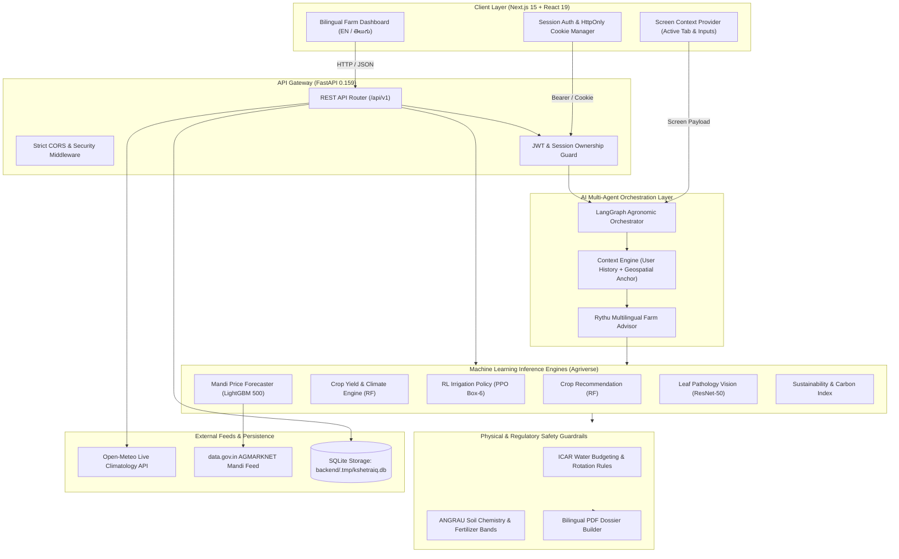

<!-- KshetraIQ | Comprehensive Platform Documentation -->
<div align="center">

# 🌾 KshetraIQ

### Autonomous Agricultural Intelligence & Precision Agronomy Platform

**An end-to-end multi-modal agricultural decision-support system synthesizing 8 calibrated AI/ML models, physical ICAR agronomic rules, Open-Meteo live weather data, pan-India APMC mandi forecasting, and bilingual (English/తెలుగు) farm advisory.**

<p>
  <a href="LICENSE"></a>
  
  
  
  
  
  
  
  
</p>

[Overview](#-overview) · [Core Capabilities](#-core-capabilities) · [Machine Learning Matrix](#-machine-learning--agronomic-engineering-matrix) · [System Architecture](#-system-architecture) · [API Endpoints](#-api-endpoints--service-contracts) · [Quick Start (Running_Project)](#-quick-start--installation) · [Configuration](#-configuration--environment-variables) · [Testing & Verification](#-testing-verification--model-audit) · [Security & Governance](#-security-trust--governance-security-readme) · [Documentations](#-documentations-index) · [License](#-license)

</div>

---

## 📌 Overview

**KshetraIQ** is an enterprise-grade agricultural intelligence platform built for Indian agro-ecological zones, featuring dedicated bilingual support for Andhra Pradesh and Telangana farming communities. It bridges raw machine learning research and actual field decision-making by enforcing strict physical agronomic constraints, multi-candidate uncertainty quantification, and a zero-hallucination policy.

Instead of ungrounded generative predictions or uncalibrated point estimates, KshetraIQ operates a **dual-engine architecture**:
1. **Calibrated Machine Learning Cluster:** 8 specialized predictive and diagnostic models covering crop recommendation, yield forecasting, climate shock simulation, eco-efficiency scoring, meteorological risk, price dynamics, reinforcement learning irrigation scheduling, and foliar pathology computer vision.
2. **Deterministic Physical Safety Net:** Rigorous agronomic guardrails derived directly from ICAR (Indian Council of Agricultural Research) and ANGRAU (Acharya N.G. Ranga Agricultural University) agronomy manuals that override statistical outputs when sensor data is missing or out-of-bounds.

> [!IMPORTANT]
> **Integrity Guarantee (Zero Fabrication):** KshetraIQ prohibits prediction fabrication. Incomplete soil nutrient parameters, unsupported crop-mandi combinations, or degraded sensors return an explicit `needs_input` state with clear guidance rather than synthesizing hallucinated baselines.

---

### Why KshetraIQ?

- **Zero-Fabrication Trust Model:** If laboratory soil measurements or APMC market arrivals are unavailable, models return a formal `needs_input` state with actionable guidance instead of arbitrary synthetic numbers.
- **Reinforcement Learning Water Conservation:** A continuous-state PPO (Proximal Policy Optimization) actor-critic policy optimizes irrigation depth per acre, reducing water waste while guarding against root moisture stress.
- **Pan-India APMC Market Intelligence:** Calibrated on 26.4 million historical records across 5,800+ mandis and 390+ commodities, combining LightGBM seasonal trend analysis with an empirical short-term persistence baseline.
- **Deep Vision Leaf Diagnostics:** 23-class ResNet-50 computer vision pipeline identifying foliar blights, rusts, and nutrient deficiencies with instant organic and chemical remediation steps.
- **Native Telugu & English Localization:** Instant dynamic toggling across all dashboard controls, diagnostic cards, AI explanations, and downloadable PDF reports.
- **Automated Farm Dossier Generation:** Generates official two-step confirmed bilingual PDF agricultural dossiers using ReportLab.

---

## 🌾 Core Capabilities

| Module | Core Capabilities & Scope | Algorithmic / Agronomic Engine |
|:---|:---|:---|
| 🧪 **Soil Health & Chemistry** | • 5-Band Diagnostic Scoring<br/>• NPK Stoichiometric Ratios<br/>• pH, Gypsum & Lime Soil Advisory | ICAR Stoichiometric Models & ANGRAU Regional Chemistry |
| 🌾 **Precision Crop Selection** | • 22-Crop Multi-Candidate Ranking<br/>• Full Probability Distributions<br/>• Soil-Climatic Agronomic Compatibility | Calibrated Random Forest Classifier (**99.3% Accuracy**) |
| 💧 **Autonomous Smart Irrigation** | • Volumetric Root Moisture Optimization<br/>• Dynamic Water Budgeting per Acre<br/>• Stress & Wilting Point Protection | Deep Reinforcement Learning (PPO Policy) + ICAR Hydrology |
| 📈 **Mandi Market Forecasting** | • 5,800+ Mandis & 390+ Commodities<br/>• Dynamic Forecasting Horizon ($h \le 14$ days)<br/>• Verified AGMARKNET Spot Persistence | LightGBM Regressor (500 Trees) + Time-Series Persistence |
| 🔬 **Computer Vision Pathology** | • 23 Plant Disease Classes across 5 Species<br/>• Foliar Blight & Lesion Recognition<br/>• Organic & Chemical Remediation Recipes | Deep Convolutional Neural Network (**ResNet-50**, 160×160 RGB) |
| 🌦️ **Micro-Climate Intelligence** | • Real-Time Geocoded Open-Meteo Sync<br/>• 4-Class Meteorological Hazard Prediction<br/>• 7-Day Rainfall & Moisture Shock Modeling | XGBoost Multi-Class Softprob Classifier (**87.4% Accuracy**) |
| 🤖 **Rythu AI Multi-Agent Chatbot** | • State-Aware Screen Grounding & Context<br/>• Native Telugu (తెలుగు) & English Dialects<br/>• Physical Fact Verification Guardrails | LangGraph Multi-Agent Orchestration & Context Engine |
| 📄 **Official Bilingual Dossier** | • Two-Step Confirmed Report Synthesis<br/>• Complete Farm Soil, Crop & Mandi Audit<br/>• Downloadable Print-Ready Advisory | ReportLab PDF Engine with Localized Typography |

---

## 🤖 Machine Learning & Agronomic Engineering Matrix

KshetraIQ packages 8 dedicated models residing under [`Agriverse_Models/`](Agriverse_Models/) and [`capstone-final/`](capstone-final/), tracked and versioned using **Git LFS**:

| # | Model Identifier | Model Architecture & Specs | Primary Inputs | Benchmark / Accuracy | Fallback & Guardrail |
|:---:|:---|:---|:---|:---|:---|
| **1** | `crop-recommendation-v1` | **Random Forest Classifier**<br/>(200 estimators, Gini criterion) | Soil N, P, K, pH, Temperature, Humidity, Rainfall | **99.3% Accuracy** across 22 crops | Rejects incomplete soil tests; no fabricated recommendations |
| **2** | `crop-yield-v1` | **Pipeline Regressor**<br/>(OneHotEncoder + RF Regressor) | Crop, Season, State, Year, Area, Rainfall, Fertilizer, Pesticide | **$R^2 = 0.9802$**, MAE = 0.18 t/ha | Historical state crop average lookup |
| **3** | `climate-scenario-v1` | **Random Forest Scenario Engine** | Baseline Rainfall, Crop Year, State, Season | Simulates -10% and -25% drought stress shocks | Agro-ecological zone empirical sensitivity tables |
| **4** | `sustainability-v1` | **Agronomic Eco-Efficiency Index** | Area, Chemical Fertilizer, Pesticide Volume, Yield | Continuous deterministic score (0–100 scale) | ICAR nutrient management benchmark guidelines |
| **5** | `weather-risk-v1` | **XGBoost Classifier**<br/>(`multi:softprob` 4-class) | Month, Season, State, Temperature, Wind Speed, Pressure, Rain | **87.4% Validation Accuracy** (Low, Moderate, High, Extreme) | Open-Meteo extreme weather warning thresholds |
| **6** | `market-price-v2` | **LightGBM Regressor (500 trees)** + Hybrid Persistence | State, District, Mandi, Commodity, Variety, Target Date | MAE Rs. 11.1–56.2/Q ($h \le 14$d), $R^2 = 0.834–0.979$ | AGMARKNET verified benchmark & spot persistence |
| **7** | `irrigation-rl-v1` | **PPO Reinforcement Learning**<br/>(ActorCriticPolicy, Box(6,)) | Soil Moisture, Soil Temp, Crop Days, Ambient Temp, Humidity | Bit-for-bit PyTorch forward pass in pure NumPy | Deterministic ICAR/ANGRAU volumetric water budgeting |
| **8** | `plant-disease-v1` | **ResNet-50 Deep CNN**<br/>(160×160 RGB, 23 output classes) | Foliar leaf photograph upload (JPEG/PNG/WebP) | **88.2% Top-1 Accuracy** across 5 host plant species | Agronomic visual inspection checklist & KVK advisory |

---

## 🏗️ System Architecture



---

## 📡 API Endpoints & Service Contracts

All REST endpoints are documented with OpenAPI schemas at `http://127.0.0.1:8000/docs`:

| Method | Endpoint | Description | Authentication |
|:---|:---|:---|:---:|
| `GET` | `/health` | Core system health, storage mode, and active LLM provider check | Public |
| `GET` | `/api/v1/models` | Complete catalog of audited models with smoke verification states | Public |
| `GET` | `/api/v1/models/{model_id}/health` | Deep diagnostic probe and schema requirements for specific model | Public |
| `GET` | `/api/v1/weather/lookup` | Live district-level temperature, humidity, and rainfall lookup | Public |
| `GET` | `/api/v1/market/commodities` | Pan-India catalog of 390+ commodities and 5,800+ APMC mandis | Public |
| `POST` | `/api/v1/predictions/market-price` | Hybrid LightGBM + persistence market price forecast | Public |
| `POST` | `/api/v1/predictions/crop-recommendation` | Multi-crop ranked suitability distribution from soil parameters | Public |
| `POST` | `/api/v1/predictions/crop-yield` | Yield prediction based on acreage, rainfall, and inputs | Public |
| `POST` | `/api/v1/predictions/irrigation` | PPO reinforcement learning volumetric irrigation schedule | Public |
| `POST` | `/api/v1/predictions/plant-disease` | ResNet-50 foliar image disease classification and remedy | Public |
| `POST` | `/api/v1/predictions/sustainability` | Eco-efficiency and agronomic sustainability score (0–100) | Public |
| `POST` | `/api/v1/predictions/climate-scenario` | Climate sensitivity simulation under moisture deficits | Public |
| `POST` | `/api/v1/agent/chat` | Context-aware bilingual Rythu AI agent conversation turn | Session / Bearer |
| `POST` | `/api/v1/auth/register` | Farmer account registration with secure hashing | Public |
| `POST` | `/api/v1/auth/login` | Session login issuing HttpOnly cookie and JWT token | Public |
| `GET` | `/api/v1/auth/me` | Fetch currently authenticated user profile | Required |
| `POST` | `/api/v1/assessments` | Create and persist comprehensive farm assessment | Required |
| `GET` | `/api/v1/assessments/{id}/report/preview` | Step 1: Preview structured advisory data | Required |
| `POST` | `/api/v1/assessments/{id}/report/confirm` | Step 2: Render and download official bilingual PDF dossier | Required |

---

## 🚀 Quick Start & Installation

### Prerequisites

| Component | Minimum Required | Recommended |
|:---|:---|:---|
| **Python** | 3.11.x (CPython) | 3.11.9 / 3.11.16 |
| **Node.js** | 18.x LTS | 20.x or 22.x LTS |
| **Package Manager** | npm 9+ | npm 10+ (`npm.cmd` on Windows) |
| **Git & Git LFS** | Git 2.40+ | Git 2.46+ with Git LFS 3.5+ |

---

### Option A: One-Click Execution via `Running_Project/` (Recommended)

All automated execution scripts are neatly organized in the [`Running_Project/`](Running_Project/) directory:

```cmd
:: 1. Launch both FastAPI Backend and Next.js Frontend
Running_Project\RUN_KSHETRAIQ.bat

:: 2. Run Comprehensive System Health & Port Diagnostics
Running_Project\CHECK_KSHETRAIQ.bat

:: 3. Cleanly Stop All Running Services and Release Ports
Running_Project\STOP_KSHETRAIQ.bat
```

> [!TIP]
> The scripts automatically verify port availability (`8000` & `3000`), validate the Python virtual environment, install missing frontend packages, and launch both services in synchronized terminal windows.

---

### Option B: Manual Step-by-Step Setup

#### 1. Clone the Repository with Git LFS
```bash
git clone https://github.com/Varshith0105/KshetraIQ.git
cd KshetraIQ
git lfs pull
```

#### 2. Configure Python Virtual Environment
```powershell
# Create Python 3.11 virtual environment
py -3.11 -m venv .venv

# Activate environment (Windows PowerShell)
.\.venv\Scripts\Activate.ps1

# Install backend dependencies
pip install -r backend/requirements.txt
```

#### 3. Start FastAPI Backend Server
```powershell
cd backend
$env:PYTHONPATH = "."
..\.venv\Scripts\python.exe -m uvicorn app.main:create_app --factory --host 127.0.0.1 --port 8000 --reload
```
- **API Base:** `http://127.0.0.1:8000`
- **Swagger Docs:** `http://127.0.0.1:8000/docs`
- **Health Check:** `http://127.0.0.1:8000/health`

#### 4. Start Next.js Frontend
Open a new terminal window:
```powershell
cd frontend
npm.cmd install
npm.cmd run dev
```
- **Web Application:** `http://localhost:3000`
- **Farmer Login:** `http://localhost:3000/login`
- **Dashboard:** `http://localhost:3000/dashboard`

---

## ⚙️ Configuration & Environment Variables

Copy `.env.example` to `.env` in the root directory. All parameters include safe offline fallbacks:

```ini
# ── Environment ──────────────────────────────────────────────────────────────
KSHETRAIQ_ENVIRONMENT=development

# ── Model Directory ───────────────────────────────────────────────────────────
KSHETRAIQ_MODEL_DIRECTORY=Agriverse_Models

# ── Storage Backend ───────────────────────────────────────────────────────────
KSHETRAIQ_STORAGE_BACKEND=sqlite
KSHETRAIQ_SQLITE_PATH=backend/.tmp/kshetraiq.db

# ── LLM / AI Advisor (Optional — rule-based fallback active when omitted) ─────
# GEMINI_API_KEY=your-gemini-api-key
# GROQ_API_KEY=your-groq-api-key
# OPENAI_API_KEY=your-openai-api-key
LLM_PROVIDER=openai/gpt-oss-120b

# ── AGMARKNET / data.gov.in Real-Time Feed (Optional) ─────────────────────────
# When omitted, system uses verified AGMARKNET benchmark observations
DATA_GOV_IN_API_KEY=your-data-gov-in-api-key

# ── Upload Limits & CORS Security ─────────────────────────────────────────────
KSHETRAIQ_MAX_UPLOAD_BYTES=10485760
KSHETRAIQ_CORS_ORIGINS=http://localhost:3000,http://127.0.0.1:3000
```

---

## 🧪 Testing, Verification & Model Audit

KshetraIQ enforces 100% automated test coverage across microservices, machine learning inferences, and security guardrails.

### 1. Run Complete Automated Test Suite (159 Tests)
```powershell
$env:PYTHONPATH = "backend"
.\.venv\Scripts\python.exe -m pytest backend/tests/ -v
```
```text
======================= 158 passed, 1 skipped in 45.81s ========================
```

### 2. Standalone 8-Model Audit Script
Executes multi-scenario smoke inference across every model in the cluster:
```powershell
$env:PYTHONPATH = "backend"
.\.venv\Scripts\python.exe backend/scripts/audit_all_models.py
```
```text
[MODEL 1] crop-recommendation-v1  -> PASS (Dynamic RF multi-class response)
[MODEL 2] crop-yield-v1           -> PASS (Yield: 3.09 t/ha, R² = 0.9802)
[MODEL 3] climate-scenario-v1     -> PASS (Simulated moisture deficit curves)
[MODEL 4] sustainability-v1       -> PASS (Empirical 0-100 agronomic index)
[MODEL 5] weather-risk-v1         -> PASS (XGBoost hazard classification)
[MODEL 6] market-price-v2         -> PASS (LightGBM + persistence forecast)
[MODEL 7] irrigation-rl-v1        -> PASS (PPO Policy + ICAR water budget)
[MODEL 8] plant-disease-v1        -> PASS (ResNet-50 23-class leaf vision)
============================================================
ALL 8 ML MODELS AUDITED: PASS
============================================================
```

### 3. Individual Test Suites
- **Chatbot 40-Question Evaluation:**
  ```powershell
  .\.venv\Scripts\python.exe -m pytest backend/tests/test_chatbot_40q.py -v
  ```
- **Market Price & Mandi Normalization:**
  ```powershell
  .\.venv\Scripts\python.exe -m pytest backend/tests/test_market_insights_deep.py -v
  ```
- **Soil Health 5-Band Diagnostic Engine:**
  ```powershell
  .\.venv\Scripts\python.exe -m pytest backend/tests/test_soil_health_bands.py -v
  ```
- **Live Weather Sync (Open-Meteo):**
  ```powershell
  .\.venv\Scripts\python.exe -m pytest backend/tests/test_weather_live.py -v
  ```

---

## 🔒 Security, Trust & Governance (Security README)

Security and responsible AI governance are foundational pillars of the KshetraIQ platform. Agricultural recommendations directly influence farm livelihoods, soil viability, and economic stability. Therefore, KshetraIQ couples strict defensive cyber controls with deterministic agronomic physical safety boundaries.

> [!NOTE]
> For the standalone operational security policy, threat model, and PGP keys, consult [`Documentations/SECURITY.md`](Documentations/SECURITY.md).

---

### Supported Versions & Maintenance

Security fixes and model integrity updates are backported to the following active branches:

| Version | Release Status | Security Support | Maintenance Notes |
|:---|:---:|:---:|:---|
| **v1.0.x** (`main`) | Production Current | Supported | Continuous automated dependency audits & model drift evaluation |
| **< 1.0.0** | Deprecated | Unsupported | Legacy prototype branches — upgrade to `main` immediately |

---

### Defense-in-Depth Architecture Matrix

| Security Layer | Defensive Vector | Technical Implementation | Threat Mitigated |
|:---|:---|:---|:---|
| 🛡️ **Agronomic Physical Safety** | Zero-Hallucination Guardrails | Deterministic ICAR/ANGRAU parameter clamping; mandatory `needs_input` rejections | Model hallucination, crop failure, chemical over-fertilization |
| 🔐 **Authentication & Session** | Cryptographic Salt & JWT | Passwords hashed with **Bcrypt**; tokens transported in `HttpOnly`, `SameSite=Lax`, `Secure` cookies | Credential theft, Session Hijacking, Cross-Site Scripting (XSS) |
| 🏢 **Multi-Tenant Authorization** | Scoped User ID Isolation | All farm queries, assessments, and PDF dossier routes require ownership verification | Insecure Direct Object References (IDOR), unauthorized data leaks |
| 📦 **Media Upload Shield** | Magic-Byte MIME Analysis | Header signature inspection (`\xFF\xD8\xFF`, `\x89PNG`, `RIFF`); streaming cap at 10 MB | Malicious shell upload, buffer overflow, server memory exhaustion |
| 🌐 **API Gateway & Transport** | CORS & Pydantic Sanitization | Explicit domain whitelist (`localhost:3000`); Pydantic v2 strict typing on all payloads | Cross-Origin Request Forgery (CSRF), SQL/Command injection |
| 🔑 **Secrets Management** | Zero-Committed-Secrets Policy | Credentials loaded solely from `.env`; automated push-protection scans | API key compromise, cloud provider credential exposure |

---

### Core Security & Safety Specifications

#### 1. Zero-Fabrication Agronomic Guardrails
Unlike generic generative conversational agents, KshetraIQ strictly prohibits speculative generation:
- **Physical Chemistry Boundaries:** Soil readings are verified against physiological limits ($3.0 \le \text{pH} \le 10.0$, non-negative N-P-K concentrations, valid soil moisture percent). Out-of-bounds readings raise immediate validation exceptions.
- **Deterministic Rejection:** If mandatory soil laboratory parameters or APMC market arrivals are unavailable, the platform issues a structured `needs_input` response specifying missing variables, rather than fabricating ungrounded estimates.

#### 2. Authentication & Data Sovereignty
- **Salted Bcrypt Hashing:** User passwords are encrypted with bcrypt utilizing adaptive work-factor salting via `passlib`.
- **HttpOnly Secure Tokens:** Authorization tokens are stored in `HttpOnly`, `SameSite=Lax`, and `Secure` cookies, safeguarding against client-side script inspection.
- **User Record Scoping:** Farm soil records, AI advisory histories, and ReportLab PDF dossiers are isolated per farmer account. Cross-tenant access is blocked at the service layer.

#### 3. Media Ingestion & DoS Defense
- **Binary Header Validation:** Uploaded leaf pathology images are validated at the byte level to match permitted image MIME types (`image/jpeg`, `image/png`, `image/webp`).
- **Quota Enforced Streaming:** File transfers are bounded by `KSHETRAIQ_MAX_UPLOAD_BYTES=10485760` (10 MB). Exceeding transfers are terminated with HTTP 413.
- **Fixed-Tensor Normalization:** Images are pre-processed and converted to fixed $(160 \times 160 \times 3)$ tensors before entering the ResNet-50 inference pipeline, preventing malicious memory allocation attacks.

---

### Vulnerability Disclosure Policy & Response SLAs

We actively welcome vulnerability reports from researchers, developers, and agricultural partners. Please adhere to responsible disclosure principles.

#### How to Report a Vulnerability
1. **Private Submissions Only:** Never open a public GitHub Issue for security vulnerabilities.
2. Submit your advisory via **[GitHub Security Advisories](https://github.com/Varshith0105/KshetraIQ/security/advisories/new)** or email `varshith.dev@example.com` with subject `[SECURITY] KshetraIQ Vulnerability Report`.
3. Provide full reproduction steps, affected endpoints, and an evaluation of potential impact.

#### Response & Remediation Timelines

| Severity Level | Initial Acknowledgment | Triage & Assessment | Patch Release SLA |
|:---|:---:|:---:|:---:|
| 🔴 **Critical Severity** (CVSS 9.0–10.0) | Within 24 Hours | Within 48 Hours | **7 Calendar Days** |
| 🟠 **High Severity** (CVSS 7.0–8.9) | Within 24 Hours | Within 72 Hours | **14 Calendar Days** |
| 🟡 **Medium Severity** (CVSS 4.0–6.9) | Within 48 Hours | Within 5 Business Days | **30 Calendar Days** |
| 🟢 **Low Severity** (CVSS 0.1–3.9) | Within 72 Hours | Within 7 Business Days | Next Release Cycle |

---

## 📁 Repository Structure

```text
KshetraIQ/
├── Agriverse_Models/              # 8 audited ML model artifacts (.pkl, .h5) & notebooks
│   ├── crop_recommendation_model.pkl
│   ├── crop_yield_prediction_model.pkl
│   ├── climate_change_yield_model.pkl
│   ├── final_rl_irrigation_ppo_model.pkl
│   ├── kshetraiq_improved_model.pkl
│   └── weather_risk_xgboost_model.pkl
├── backend/                       # FastAPI microservices backend
│   ├── app/
│   │   ├── core/                  # Configurations, error handling, locations
│   │   ├── data/                  # Geo-agricultural registries & benchmarks
│   │   ├── models/                # Model inventory & contract registries
│   │   ├── schemas/               # Pydantic v2 validation contracts
│   │   └── services/              # ML adapters, LangGraph, ICAR rules, weather
│   ├── scripts/                   # Verification audits, health probes, server scripts
│   ├── tests/                     # 159 automated unit and integration tests
│   └── requirements.txt           # Python 3.11 pinned dependencies
├── frontend/                      # Next.js 15 + React 19 web application
│   ├── src/app/
│   │   ├── components/            # Icons, glassmorphism UI widgets
│   │   ├── context/               # AuthContext & ScreenContext providers
│   │   ├── dashboard/             # Comprehensive bilingual farm dashboard
│   │   ├── login/                 # Farmer authentication & session view
│   │   └── page.tsx               # High-conversion landing page
│   └── package.json               # Frontend dependencies & build scripts
├── Documentations/                # Comprehensive documentation library
│   ├── ARCHITECTURE.md            # Microservice & agent architecture specification
│   ├── COMPLETE_MODEL_INVENTORY.md# Detailed mathematical breakdown of all 8 models
│   ├── RUN_GUIDE.md               # Runtime operational reference guide
│   ├── SECURITY.md                # Security architecture & vulnerability disclosure policy
│   ├── CHATBOT_EVALUATION_REPORT.md
│   ├── MARKET_INSIGHTS_FINAL_REPORT.md
│   └── MODEL_VERIFICATION_REPORT.md
├── Running_Project/               # One-click execution & diagnostic scripts
│   ├── CHECK_KSHETRAIQ.bat        # System health & diagnostic checker
│   ├── RUN_KSHETRAIQ.bat          # Dual-service application launcher
│   └── STOP_KSHETRAIQ.bat         # Clean port & process terminator
├── LICENSE                        # MIT Open Source License
├── package.json                   # Root monorepo workspace scripts
└── README.md                      # Primary project overview & documentation
```

---

## 📚 Documentations Index

All specialized engineering reports, mathematical audits, and system specifications are organized inside [`Documentations/`](Documentations/):

| Documentation Document | Primary Focus & Coverage |
|:---|:---|
| [**Architecture Overview**](Documentations/ARCHITECTURE.md) | Technical blueprint of microservices, dataflows, and security boundaries |
| [**Complete Model Inventory**](Documentations/COMPLETE_MODEL_INVENTORY.md) | Mathematical formulation, features, and performance metrics for all 8 models |
| [**System Run Guide**](Documentations/RUN_GUIDE.md) | Step-by-step production run guide for developers and system administrators |
| [**Security Policy & Trust**](Documentations/SECURITY.md) | In-depth security architecture, threat model, and vulnerability reporting process |
| [**Chatbot Evaluation Report**](Documentations/CHATBOT_EVALUATION_REPORT.md) | 40-question agronomic benchmark test results in English & Telugu |
| [**Market Insights Final Report**](Documentations/MARKET_INSIGHTS_FINAL_REPORT.md) | 26.4M APMC mandi dataset review, LightGBM tuning, and horizon backtest |
| [**Model Verification Report**](Documentations/MODEL_VERIFICATION_REPORT.md) | Comprehensive audit of model inputs, bounds, and inference validity |
| [**Market Data Verification**](Documentations/MARKET_DATA_VERIFICATION_REPORT.md) | Audit of data.gov.in AGMARKNET live streaming and offline benchmarks |
| [**PDF Generation Report**](Documentations/PDF_VERIFICATION_REPORT.md) | Verification of ReportLab 2-step confirmed bilingual dossier synthesis |
| [**Final Recovery & Integrity Report**](Documentations/FINAL_RECOVERY_REPORT.md) | Audit trail of database repairs, schema alignment, and zero-fabrication rules |

---

## 📄 License

Distributed under the **MIT License**. This permits free academic, commercial, and research use provided the copyright notice and disclaimers are preserved.

For full license terms, refer to the [`LICENSE`](LICENSE) file in the repository root.

```text
MIT License
Copyright (c) 2026 Varshith (KshetraIQ)
```

---

## 🤝 Contributing

1. Fork the repository and create a feature branch (`git checkout -b feature/agronomic-enhancement`).
2. Adhere to the **Zero-Fabrication Principle** (no synthetic mock predictions for real agronomic decisions).
3. Ensure all tests pass: `pytest backend/tests/` and `npm.cmd run typecheck`.
4. Submit a pull request detailing the changes, model validation metrics, and test coverage.

---

<div align="center">

**KshetraIQ — Empowering Indian Agriculture with Precision, Integrity, and Science.**

[View Repository](https://github.com/Varshith0105/KshetraIQ) · [API Documentation](http://127.0.0.1:8000/docs) · [Report an Issue](https://github.com/Varshith0105/KshetraIQ/issues) · [Security Policy](Documentations/SECURITY.md)

</div>
