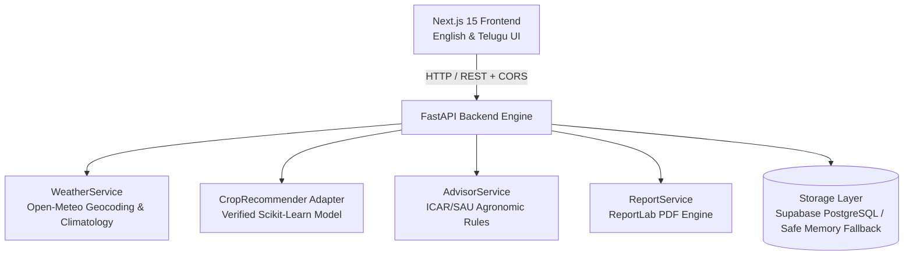

# KshetraIQ — AI-Powered Agricultural Intelligence Platform

> **"Know Your Land. Grow With Confidence."**
> *"మీ భూమిని తెలుసుకోండి. నమ్మకంతో సాగు చేయండి."*

KshetraIQ is a production-grade, AI-powered agricultural decision-support platform designed specifically for Indian farmers, with specialized focus on Andhra Pradesh and Telugu-speaking farming communities.

---

## 🌟 Key Highlights & Engineering Principles

1. **Zero Fabrication & Trust-First AI**:
   - The platform audits machine learning artifacts rigorously. Uncalibrated or incomplete models are blocked with explicit explanatory contract notes rather than returning pseudo-random or fabricated predictions.
   - Crop recommendations use a verified 7-feature Scikit-Learn Random Forest / Decision Tree model (`N`, `P`, `K`, `temperature`, `humidity`, `ph`, `rainfall`), returning ranked multi-candidate probability distributions.
2. **Deterministic Agronomic Advisor**:
   - Powered by ICAR (Indian Council of Agricultural Research) and State Agricultural Universities (ANGRAU) guidance.
   - Diagnoses soil pH (strongly acidic to strongly alkaline), NPK nutrient balances, and irrigation schedules.
   - Fully localized in **English** and **Telugu (తెలుగు)**.
3. **Live Geocoded Agro-Climatic Intelligence**:
   - Integrated with Open-Meteo API to fetch real-time temperature, relative humidity, and precipitation based on district/mandal geography, with manual override capability for farmers.
4. **Two-Step Confirmed PDF Advisory Reports**:
   - Built with ReportLab, producing official, bilingual PDF farm dossiers.
   - Requires an explicit preview and confirmation dialog before generating or downloading to prevent accidental batch operations.
5. **Modern, Bilingual Dashboard UI**:
   - Built with Next.js 15, React 19, and Tailwind CSS.
   - Sleek glassmorphism aesthetic, high-contrast accessible typography, mobile-responsive layouts, and instant English/Telugu toggling.

---

## 🏗️ System Architecture



---

## 🚀 Getting Started

### Prerequisites
- **Python 3.11+** (Tested on Python 3.13)
- **Node.js 18+** & **npm**

### 1. Backend Setup & Run

Open a PowerShell terminal in `E:\CapstoneProject`:

```powershell
# Activate existing virtual environment (or create with python -m venv .venv)
.\.venv\Scripts\Activate.ps1

# Install dependencies
pip install -r backend\requirements.txt

# Start the FastAPI server on port 8000
$env:PYTHONPATH = "backend"
uvicorn app.main:app --app-dir backend --host 127.0.0.1 --port 8000 --reload
```

The API will be available at:
- **Interactive OpenAPI Docs**: `http://localhost:8000/docs`
- **Health Check**: `http://localhost:8000/health`

### 2. Frontend Setup & Run

In a second terminal:

```powershell
cd E:\CapstoneProject\frontend

# Install dependencies (if not already installed)
npm install

# Start the development server
$env:NEXT_PUBLIC_API_URL = "http://localhost:8000"
npm run dev
```

Open your browser at `http://localhost:3000`.

---

## 📡 API Endpoints

| Method | Endpoint | Description |
|---|---|---|
| `GET` | `/health` | System health check and configuration status |
| `GET` | `/api/v1/models` | Registry catalog of models and contract audit states |
| `GET` | `/api/v1/weather/lookup` | Live district weather lookup from Open-Meteo |
| `POST` | `/api/v1/assessments` | Create a comprehensive farm assessment |
| `GET` | `/api/v1/assessments/{id}` | Retrieve existing assessment record |
| `GET` | `/api/v1/assessments/{id}/report/preview` | Step 1: Summary preview before PDF generation |
| `POST` | `/api/v1/assessments/{id}/report/confirm` | Step 2: Confirm and download bilingual PDF report |

---

## 🧪 Verification & Automated Testing

### Backend Test Suite
All 12 backend unit and integration tests verify:
- API health and model registry checks
- Guard against fabricating predictions on incomplete soil inputs
- Rejection of invalid inputs (e.g. soil pH outside 3.0–10.0)
- Verified crop inference against the production model
- Deterministic ICAR/SAU agronomic advice generation
- Two-step PDF report generation flow
- Strict CORS preflight and origin verification

Run tests via:
```powershell
$env:PYTHONPATH = "backend"
.\.venv\Scripts\python.exe -m pytest backend/tests -v
```

### Frontend Production Build
Run:
```powershell
cd frontend
npm run build
```
Builds cleanly with zero TypeScript or ESLint errors.
